# person_detection 소프트웨어 설계서 (설계1)

- **프로젝트명:** person_detection
- **설계 기준:** `요구사항2.md` (기본 R001~R008 + 추가 R009~R015)
- **설계 기법:** UML(5장 모델링) + 데이터흐름도·결정 테이블(6장 프로세스 모델링)
- **표기:** 모든 다이어그램은 PlantUML 문법으로 작성

---

## 1. 시스템 개요

카페·식당에서 촬영한 고객 이미지를 업로드하면 YOLO 기반 얼굴 검출 모델로 **얼굴 수**를 산출하고, 결과를 사용자별로 저장해 이력과 시간대별·일별 통계를 제공하는 웹 소프트웨어이다.

| 구분 | 구성 | 역할 |
|---|---|---|
| Client | Node.js + Express Web Server, HTML/CSS/JS, Chart.js | 화면 제공, 로그인 쿠키 관리, API 프록시, 통계 그래프 |
| Server | Python FastAPI + YOLO(yolov8n-face) | 인증, 이미지 검증, 얼굴 검출, 이력·통계 API |
| Database | SQLite | 사용자, 로그인 세션, 분석 이력 저장 |

### 설계 원칙

1. **얼굴 검출 전용 모델 사용:** 사람 전체(COCO person)가 아닌 얼굴 검출 가중치를 사용한다. 결과는 "검출된 얼굴 수"이며 실제 고객 수와 다를 수 있음을 화면에 안내한다. (R002, R003.0001.0001)
2. **상태 기반 이력:** 모든 분석은 `COMPLETED` 또는 `FAILED` 상태로 기록한다. 통계는 `COMPLETED`이면서 유효한 계수값만 집계한다. (R005.0001.0001, R011)
3. **재분석은 새 이력:** 실패한 분석을 다시 실행하면 기존 행을 덮어쓰지 않고, `retry_of`로 원본을 참조하는 새 행을 만든다. (R010, R011.0001.0001)
4. **DB 접근 일원화와 사용자 범위 제한:** DB에는 FastAPI만 접근한다. 모든 조회 조건에 로그인 사용자 ID를 포함한다. (R005.0002.0001, R015)
5. **오류 정보 분리:** 사용자에게는 조치 가능한 요약 메시지만 보여 주고, 내부 예외와 DB 경로는 서버 로그에만 남긴다. (R007.0001.0001, R008.0002.0001)

---

## 2. 요구사항 분석 요약

| 구분 | 번호 | 요구사항 | 중요도 | 설계 반영 요소 |
|---|---|---|---|---|
| 기본 | R001 | 이미지 분석 입력 | 상 | UC-02, ImageValidator, POST /api/analyses |
| 기본 | R002 | 얼굴 검출 및 인원 계수 | 상 | FaceDetector(YOLO), AnalysisService |
| 기본 | R003 | 분석 결과 제공 | 상 | UC-03, 결과 화면, 안내 문구 |
| 기본 | R004 | 사용자 정보 관리 | 상 | UC-01, UC-08, User, AuthService |
| 기본 | R005 | 분석 결과 저장 및 조회 | 상 | Analysis 엔티티, UC-04 |
| 기본 | R006 | 시간대별 고객 수 통계 | 상 | UC-05, StatisticsService |
| 기본 | R007 | 기본 오류 처리 | 상 | 공통 오류 응답, 상태 다이어그램 |
| 기본 | R008 | 데이터 무결성 및 기본 보안 | 상 | FK/CHECK 제약, bcrypt, 토큰 |
| 추가 | R009 | 강화된 이미지 검증 | 중 | ImageValidator(확장자·크기·디코딩) |
| 추가 | R010 | AI 분석 실패 및 재처리 | 중 | UC-06, reanalyze(), retry_of |
| 추가 | R011 | 분석 데이터 품질 관리 | 중 | 집계 대상 결정 테이블 |
| 추가 | R012 | 분석 이력 검색 및 정렬 | 중 | UC-04 확장, 기간·정렬 파라미터 |
| 추가 | R013 | 통계 기간 및 단위 선택 | 중 | unit=hour/day, Chart.js 그래프 |
| 추가 | R014 | 통계 CSV 내보내기 | 하 | UC-07, export_csv() |
| 추가 | R015 | 사용자 접근 권한 관리 | 중 | 토큰 검증, user_id 범위 제한 |

---

## 3. 데이터흐름도 (6장 프로세스 모델링)

### 3.1 상황도 (Context Diagram)

시스템 전체를 하나의 프로세스(0)로 보고, 외부 개체(소스/싱크)와 주고받는 데이터 흐름만 나타낸다.

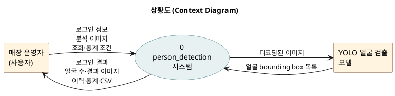

### 3.2 레벨-0 데이터흐름도 (Level-0 DFD)

상황도의 프로세스를 5개의 주요 프로세스로 분해한다. 입력과 출력은 상황도와 균형을 이룬다.

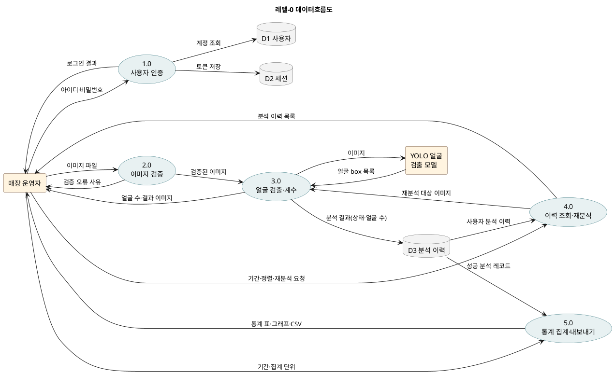

### 3.3 결정 테이블 (논리 모델링)

**① 업로드 이미지 처리 결정 (R001, R009)**

| 조건 / 규칙 | 1 | 2 | 3 | 4 | 5 |
|---|---|---|---|---|---|
| 파일이 첨부됨 | N | Y | Y | Y | Y |
| 허용 확장자 (jpg·jpeg·png·webp·bmp) | - | N | Y | Y | Y |
| 크기 10MB 이하 | - | - | N | Y | Y |
| 실제 이미지로 디코딩 가능 | - | - | - | N | Y |
| **행동: 오류 안내 후 분석하지 않음** | X | X | X | X | |
| **행동: 얼굴 검출 실행** | | | | | X |

**② 통계 집계 대상 결정 (R006.0001, R011.0001)**

| 조건 / 규칙 | 1 | 2 | 3 | 4 |
|---|---|---|---|---|
| 본인(user_id) 분석 | N | Y | Y | Y |
| 상태 = COMPLETED | - | N | Y | Y |
| 얼굴 수가 0 이상의 정수 | - | - | N | Y |
| **행동: 통계에서 제외** | X | X | X | |
| **행동: 통계에 합산** | | | | X |

---

## 4. 사용 사례 모델링

### 4.1 사용 사례 다이어그램

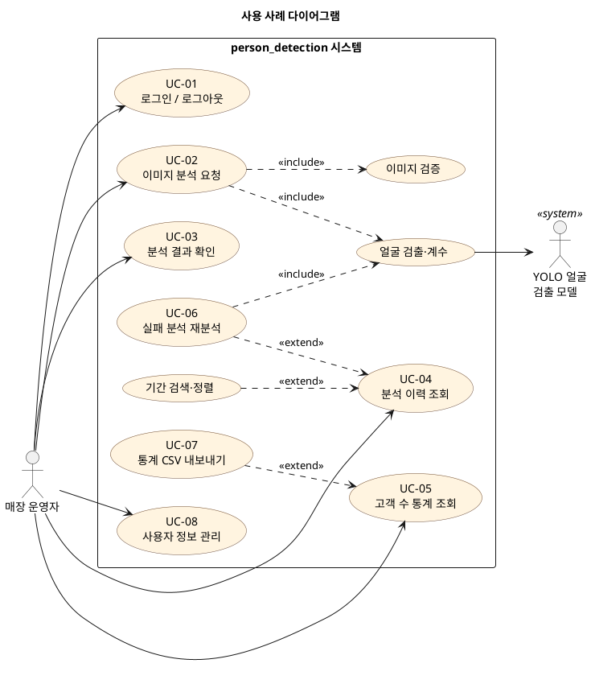

### 4.2 사용 사례 명세: UC-02 이미지 분석 요청

| 항목 | 내용 |
|---|---|
| 액터 | 매장 운영자(주 액터), YOLO 얼굴 검출 모델(보조 액터) |
| 사전 조건 | 운영자가 로그인되어 있다. |
| 기본 흐름 | 1. 운영자가 이미지를 선택하면 미리보기가 표시된다. 2. 운영자가 [얼굴 검출 분석]을 누른다. 3. 시스템이 파일 첨부 여부, 확장자, 크기, 실제 디코딩 여부를 검증한다. 4. 시스템이 원본 이미지를 저장하고 YOLO 모델로 얼굴을 검출한다. 5. 시스템이 검출된 얼굴 수(정수)를 `COMPLETED` 상태로 저장한다. 6. 시스템이 얼굴 수, bounding box 이미지, 의미 안내 문구를 표시한다. |
| 대안 흐름 | 3a. 검증 실패: 분석하지 않고 사유를 안내한다. 이 경우 DB에 저장하지 않는다. 4a. 모델 오류: `FAILED` 상태와 실패 사유를 저장하고 오류 요약을 안내한다. 이후 UC-06으로 재분석할 수 있다. 5a. 얼굴 미검출: 0명으로 `COMPLETED` 저장한다. |
| 사후 조건 | 분석 결과가 사용자 ID, 분석 시각, 상태와 함께 저장된다. |
| 관련 요구사항 | R001, R002, R003, R005, R007, R009 |

### 4.3 사용 사례 목록

| ID | 사용 사례 | 설명 | 요구사항 |
|---|---|---|---|
| UC-01 | 로그인/로그아웃 | 아이디·비밀번호로 로그인하고 토큰 쿠키를 발급받는다. | R004, R008.0002, R015 |
| UC-02 | 이미지 분석 요청 | 위 명세 참조 | R001, R002, R009 |
| UC-03 | 분석 결과 확인 | 얼굴 수, 상태, 결과 이미지, 안내 문구 확인 | R003 |
| UC-04 | 분석 이력 조회 | 기간 검색, 최신/오래된 순 정렬 | R005, R012 |
| UC-05 | 고객 수 통계 조회 | 기간과 단위(시간대/일)를 선택해 표·그래프 확인 | R006, R013 |
| UC-06 | 실패 분석 재분석 | 실패 분석을 다시 실행하고 새 이력으로 저장 | R010, R011.0001.0001 |
| UC-07 | 통계 CSV 내보내기 | 화면과 같은 조건의 통계를 CSV로 다운로드 | R014 |
| UC-08 | 사용자 정보 관리 | 내 정보 조회·수정, 비밀번호 변경, 사용자 등록·삭제 | R004 |

---

## 5. 정적 모델링

### 5.1 클래스 후보 (엔티티 / 경계 / 제어)

| 유형 | 클래스 | 역할 |
|---|---|---|
| 엔티티 | User, Session, Analysis, FaceBox, StatRow | 저장·추적해야 하는 정보 |
| 경계 | LoginView, AnalyzeView, HistoryView, StatsView, UserView, WebServer(Express), FaceDetector | 사용자 입력·출력, 외부 모델과의 접점 |
| 제어 | AuthService, ImageValidator, AnalysisService, StatisticsService | 사용 사례의 처리 흐름 제어 |

### 5.2 클래스 다이어그램

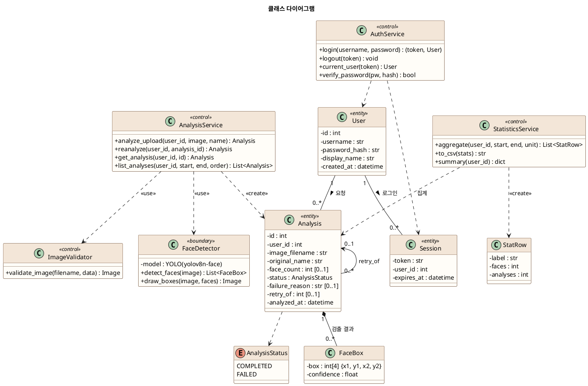

### 5.3 ERD (데이터베이스 설계)

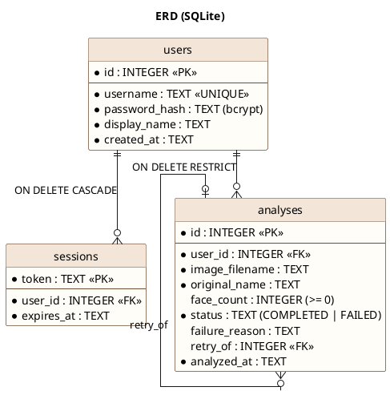

| 제약 조건 | 목적 | 요구사항 |
|---|---|---|
| `face_count IS NULL OR face_count >= 0` | 음수 계수값 저장 방지 | R008.0001 |
| `status IN ('COMPLETED','FAILED')` | 상태 값 제한 | R005.0001.0001 |
| `status='FAILED' OR face_count IS NOT NULL` | 성공 결과에는 계수값 필수 | R011.0001 |
| `users → analyses ON DELETE RESTRICT` | 이력이 있는 사용자 삭제 방지 | R004.0001.0001 |
| 인덱스 `(user_id, analyzed_at)` | 사용자별 기간 조회·통계 성능 | R012, R013 |

---

## 6. 동적 모델링

### 6.1 시퀀스 다이어그램: 이미지 분석 (UC-02)

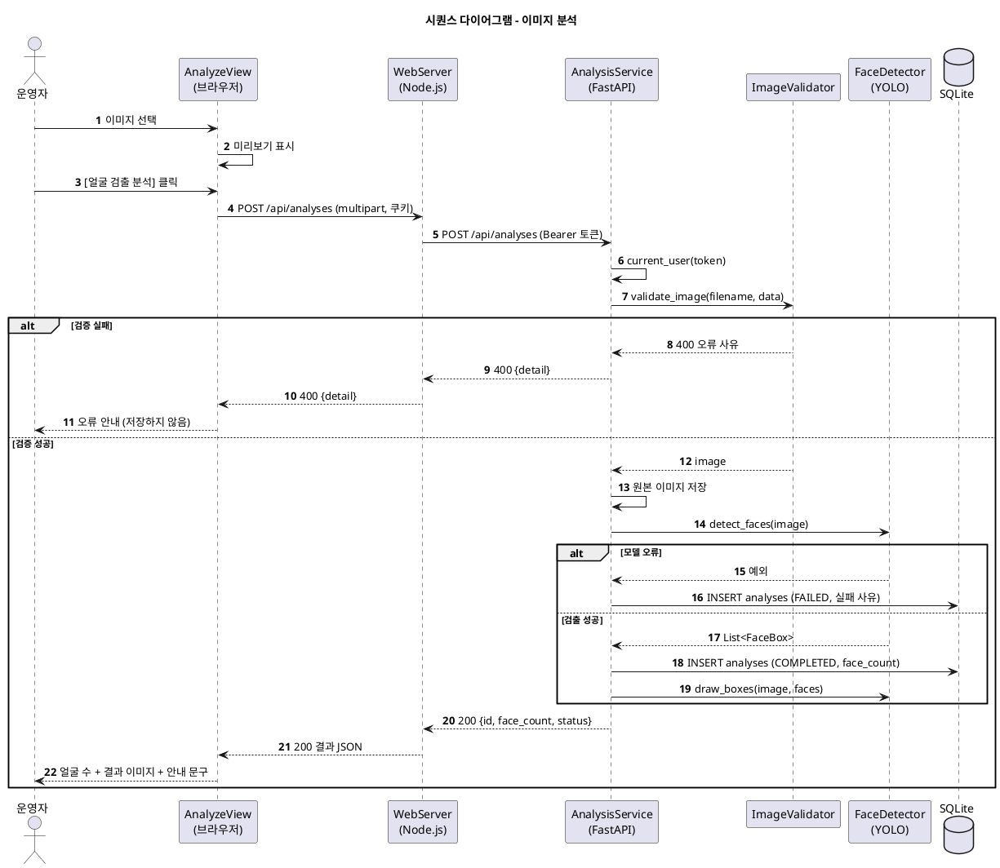

### 6.2 시퀀스 다이어그램: 통계 조회 및 CSV (UC-05, UC-07)

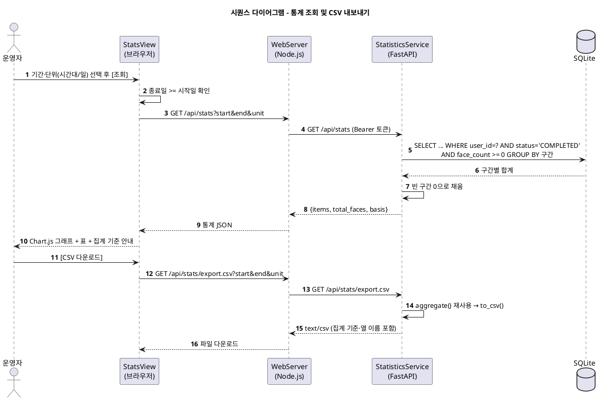

### 6.3 상태 다이어그램: 분석 요청 (Analysis)

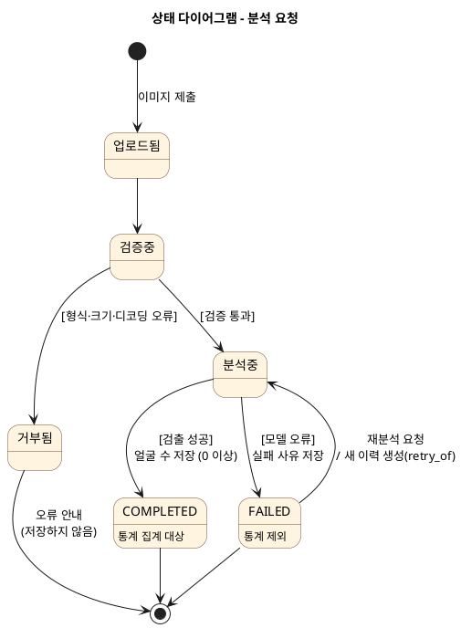

### 6.4 액티비티 다이어그램: 이미지 분석 처리 흐름

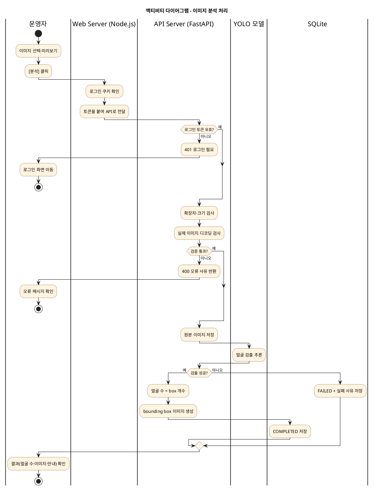

---

## 7. 구조 설계

### 7.1 컴포넌트(패키지) 다이어그램

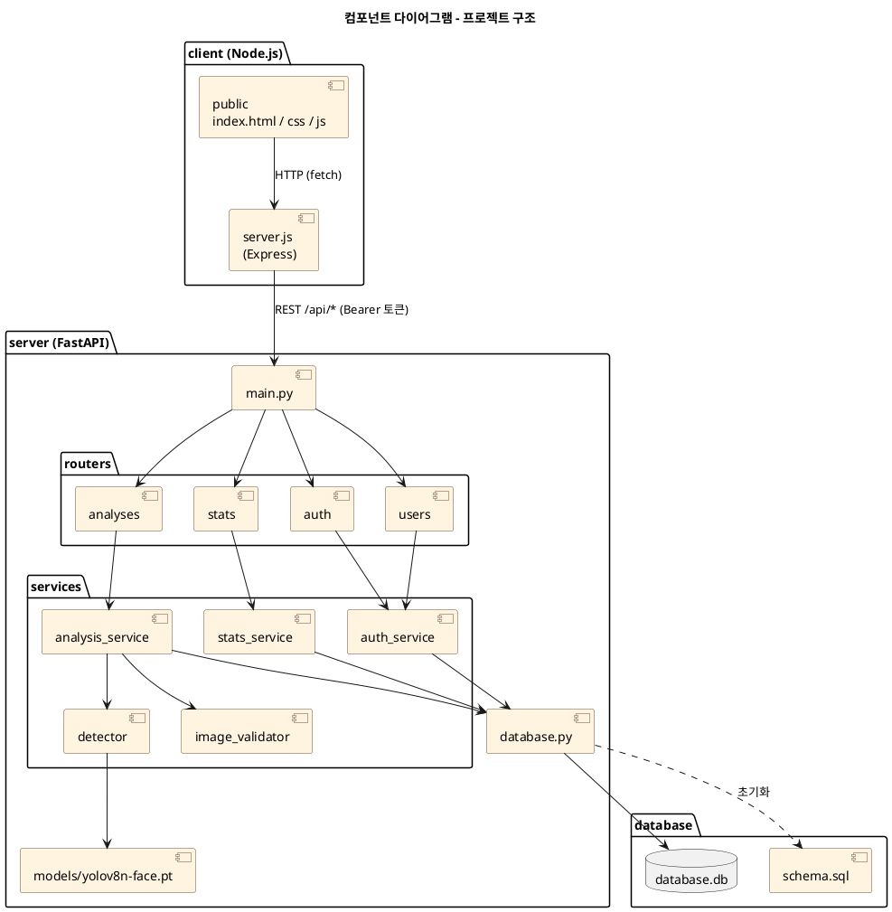

### 7.2 배치 다이어그램

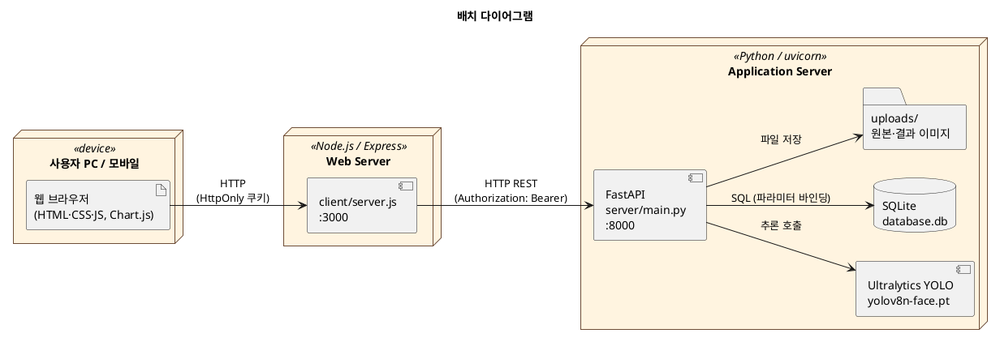

---

## 8. 인터페이스 설계 (REST API)

| Method | Endpoint | 설명 | 요구사항 |
|---|---|---|---|
| POST | `/auth/login` (Node) → `/api/auth/login` | 로그인, 토큰 발급(쿠키 저장) | R004, R015 |
| POST | `/auth/logout` (Node) → `/api/auth/logout` | 로그아웃, 토큰 폐기 | R008.0002 |
| GET | `/api/auth/me` | 로그인 사용자 정보 | R004.0001 |
| POST / PUT / DELETE | `/api/users`, `/api/users/me`, `/api/users/me/password` | 사용자 등록, 정보·비밀번호 수정, 삭제 | R004.0001 |
| POST | `/api/analyses` | 이미지 업로드 및 얼굴 검출 | R001, R002, R009 |
| GET | `/api/analyses?start&end&order` | 분석 이력 조회(기간·정렬) | R005, R012 |
| GET | `/api/analyses/{id}`, `/api/analyses/{id}/image` | 결과 상세, bounding box 이미지 | R003 |
| POST | `/api/analyses/{id}/retry` | 실패 분석 재분석(새 이력) | R010 |
| GET | `/api/stats?start&end&unit=hour\|day` | 시간대별/일별 통계 | R006, R013 |
| GET | `/api/stats/export.csv` | 통계 CSV 다운로드 | R014 |

- **공통 오류 응답:** `{"detail": "사용자용 요약 메시지"}`. 상태 코드는 400(입력), 401(인증), 404(없음/타인 데이터), 409(충돌), 500(내부 오류)이다.

---

## 9. 화면 설계

| 화면 | 주요 구성 | 요구사항 |
|---|---|---|
| 로그인 | 아이디·비밀번호 입력, 오류 메시지, 테스트 계정 안내 | R004 |
| 대시보드 | 오늘 얼굴 수, 성공·실패 건수, 최근 분석 5건 | R003, R005 |
| 이미지 분석 | 업로드·드래그앤드롭, 미리보기, 로딩 표시, 결과 카드 | R001~R003 |
| 분석 결과 | 얼굴 수, bounding box 이미지, 의미 안내, 실패 시 재분석 | R003, R010 |
| 분석 이력 | 시작일·종료일, 정렬, 상태 배지, 재분석 버튼 | R005, R012 |
| 통계 | 시간대별/일별 전환, 기간 선택, 막대 그래프(수치 표시), 표, CSV | R006, R013, R014 |
| 사용자 관리 | 내 정보, 이름·비밀번호 변경, 사용자 등록, 계정 삭제 | R004 |

---

## 10. 범위 및 한계

- 얼굴 검출 결과는 실제 고객 수와 다를 수 있다. 뒷모습, 탑뷰의 정수리, 가려진 얼굴은 검출되지 않을 수 있다.
- 같은 고객이 여러 이미지에 찍히면 통계에서 중복 집계된다. 화면과 CSV에 이 기준을 표시한다.
- 주별·월별 집계, 자동 재시도, 전문 검색은 요구사항2에 따라 범위에서 제외한다.
